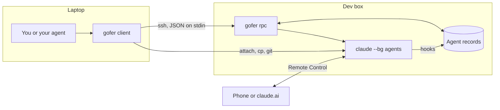

# Architecture

Gofer lets a laptop start and follow Claude Code agents on a dev box. It adds no server of its own: Claude Code runs the agents, and gofer starts them, keeps a small record of each one, and reports on them over SSH.

## How a command runs

Every command opens one SSH connection, runs `gofer rpc` on the dev box with a JSON request on stdin, reads one JSON response, and exits. Nothing of gofer's stays running. If the two versions differ, the client installs its own copy on the dev box and retries.

Connections only go from the laptop to the dev box. Agents can't reach the laptop, so results wait on the dev box until the laptop asks for them. That's why a sleeping laptop loses nothing.

| Command | What happens on the dev box |
|---|---|
| `run` | Claims the name under a lock, writes the agent's record and hook settings, adds a worktree if asked, then starts `claude --bg` |
| `ls`, `logs` | Combines `claude agents` with gofer's records and Claude's transcripts |
| `wait` | Checks state in slices of under a minute, so the client can reconnect between them |
| `send` | Writes to the agent's inbox socket, or wakes a stopped agent with `claude --bg --resume`, then looks for the message in the transcript |
| `attach`, `cp` | The client opens its own `ssh`, `scp` or Rex connection |

## Handing off code

A `--worktree` run pushes your exact HEAD to a private `refs/gofer/<request-id>` ref on the dev box. The server creates `agent/<name>` from it in `.claude/worktrees/<name>`, then deletes the ref. Work comes back with `git fetch`, and `gofer rm` refuses until you have fetched it.

## Where state lives

| Location | Contents |
|---|---|
| `~/.local/state/gofer/agents/<name>/` on the dev box | Record, event log, hook settings, locks, long briefs |
| `~/.local/share/gofer/gofer` on the dev box | The installed binary |
| `~/.config/gofer/config.json` on the laptop | Hosts, root folders, terminal choice |
| `~/.claude/skills/gofer/SKILL.md` on the laptop | The skill for your local Claude |

Claude stays the source of truth for whether a session is running. Gofer's records add what Claude doesn't keep: the agent's name, its branch, its last input and the events shown in `gofer ls`.

## Design choices

- **No daemon:** a short-lived `gofer rpc` per command means there's nothing to supervise, and upgrades are a file copy.
- **Per-session hooks:** hooks go in through `claude --settings`, so your Claude settings are never changed.
- **Retries are safe:** each `run` carries a request ID, so a retry after a lost connection returns the same agent.
- **Honest delivery:** the inbox socket gives no reply, so `send` checks the transcript and exits 3 if it can't confirm delivery.
- **`--bg`, not `claude -p`:** background sessions can be attached to and followed from a phone.
- **One binary:** Go with no dependencies outside the standard library. The client embeds Linux binaries, so a Mac can install on a Linux box.

## Code layout

| Package | Runs on | Responsibility |
|---|---|---|
| `internal/cmd` | Laptop | Commands, flags and output |
| `internal/config` | Laptop | Config file and host discovery |
| `internal/transport` | Laptop | SSH, RPC calls and installing on the dev box |
| `internal/terminal` | Laptop | Attaching over SSH or Rex |
| `internal/payload` | Laptop | Embedded Linux binaries |
| `internal/server` | Dev box | RPC handlers and agent lifecycle |
| `internal/store` | Dev box | Agent records, events and locks |
| `internal/driver/claude` | Dev box, mostly | Everything specific to Claude Code: CLI calls, hooks and transcripts |
| `internal/core` | Both | Types that cross SSH |
| `internal/proc` | Both | Running commands with time limits |
| `skill` | Laptop | The embedded skill |

Only `internal/driver/claude` knows Claude Code's formats, so a change in Claude Code should stay in that package.
