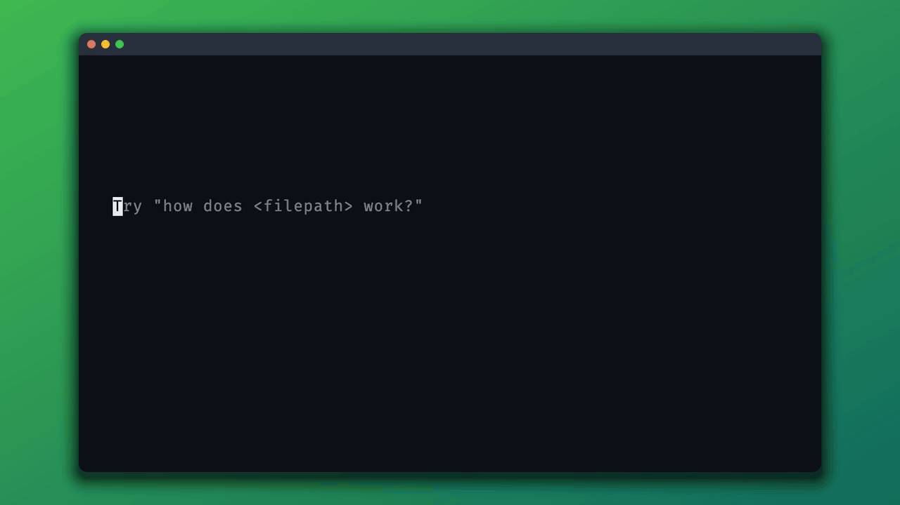

<div align="center">

<picture>
  <source media="(prefers-color-scheme: dark)" srcset="docs/logo-text-dark.svg">
  
</picture>

<br>
<br>

**Subagents that run on your dev box.**

Hand work to an agent from Claude Code, shut your laptop, and check the result later. You can follow it from your phone or open its terminal at any point.

It's plain SSH and the real Claude Code, so there's nothing to host.

<br>



</div>

## How it works

<p align="center">
  
</p>

Your local Claude uses Gofer much like a subagent. It starts an agent on the box, waits, and reads what the agent did. You can run the same commands yourself, and `--worktree` sends your current commit to a new branch on the box, even if you haven't pushed it.

Each command runs `gofer rpc` over SSH and exits, so nothing of Gofer's stays running. Agents are ordinary `claude --bg` sessions. They keep going when your laptop sleeps, and the results stay on the box until you ask for them. Hooks are set per session, and the only things Gofer saves to your Claude config are folder trust and `--bypass` acceptance.

## Quick start

You need SSH key login to your dev box. The laptop can be macOS or Linux, and the dev box Linux. Tested with Claude Code 2.1.316.

```sh
curl -fsSL https://raw.githubusercontent.com/anjay-goel/gofer/main/install.sh | sh
gofer init
```

`gofer init` sets up the box and installs skills for Claude Code, then offers to run `/dev-box-setup` for your tools, CLIs and MCP servers.

Then ask Claude:

```text
> Hand this off to gofer and tell me when it's done.
> Use gofer to run the full test suite on the dev box.
> Start gofer agents to fix the lint errors in api and web.
> What are my gofer agents doing?
```

Later, `gofer ls` shows what happened, starting with anything that needs you:

```text
NAME   STATE    CHANGED   COMMITS    SUMMARY
docs   blocked  5m ago               Run gofer attach docs
auth*  idle     2h ago    4 commits  Fixed the refresh race, one test still skipped
api    running  just now  1 commit
```

### By hand

```sh
gofer run api "fix the flaky auth test" --name auth
gofer run api --doc plan.md --worktree --name auth
gofer wait auth
```

`--worktree` sends your committed HEAD to a new `agent/auth` branch. `gofer diff auth` shows the work, and `gofer fetch auth` brings it back to a local `agent/auth` branch.

## Commands

| Command | What it does |
| --- | --- |
| `gofer run <dir> "<prompt>"` | Start an agent |
| `gofer ls` | See outcomes, with what needs you first |
| `gofer logs <name>` | Read the conversation and get the follow link |
| `gofer wait <name>...` | Block until finished or stuck |
| `gofer send <name> "<msg>"` | Message or wake an agent |
| `gofer attach <name>` | Open the full TUI, Ctrl+Z detaches |
| `gofer cp <file> <name>:` | Copy files to an agent |
| `gofer cp <name>:<path> <local>` | Copy files back |
| `gofer diff <name>` | Show what it changed since it started, including uncommitted work |
| `gofer fetch <name>` | Bring its branch into a local `agent/<name>` branch |
| `gofer stop <name>` | Stop it, keep the conversation |
| `gofer rm <name>...` | Remove them and their worktrees, keep the branches |
| `gofer doctor` | Check the setup |
| `gofer completion bash\|zsh\|fish` | Print a completion script |

Run `gofer <command> --help` for options and exit codes.

## Good to know

- `<dir>` has to exist on the dev box already. `.` means the folder with the same name as your current one.
- Gofer accepts Claude's trust prompt for folders in your working directory, but not for the home folder itself.
- Agents ask questions in plain text, so `gofer send` can answer them. Permission prompts need `gofer attach`.
- `--bypass` skips permission checks. The first use sets `skipDangerousModePermissionPrompt` in your Claude settings.
- Following an agent needs a claude.ai login. Phone push is turned on for agents, but delivery is untested.
- `gofer wait` keeps waiting on a `/loop` agent, so give it a `--timeout`.
- Sessions started from the Claude app show as `remote`. You can message them, but not attach. `/dev-box-setup` can set this up.

## Development

Building needs a current Go release.

```sh
make test
make install
```

See [AGENTS.md](AGENTS.md) for project rules. Only `internal/driver/claude` knows Claude Code's formats.

## License

MIT
